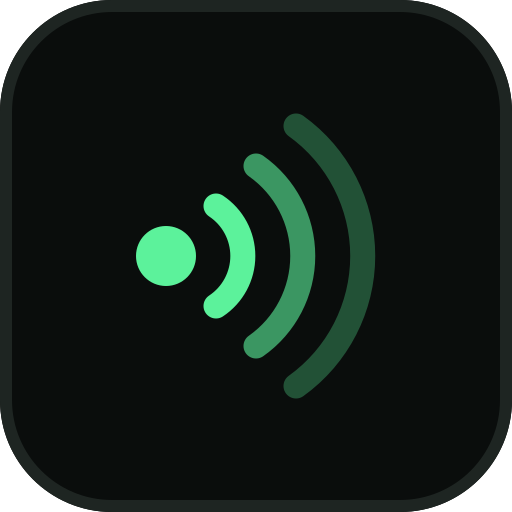
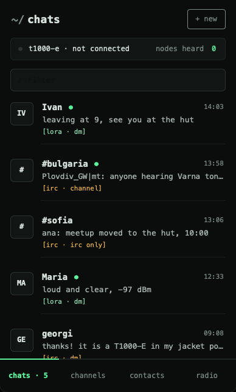
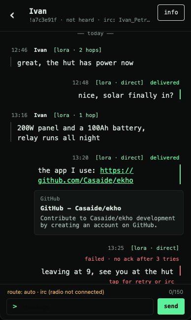
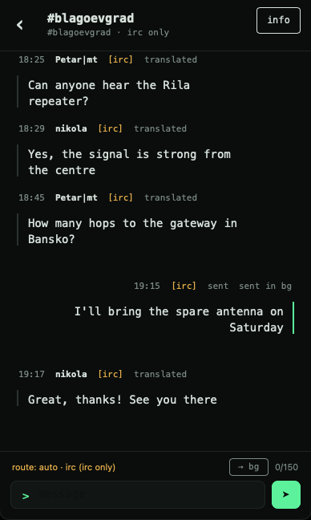
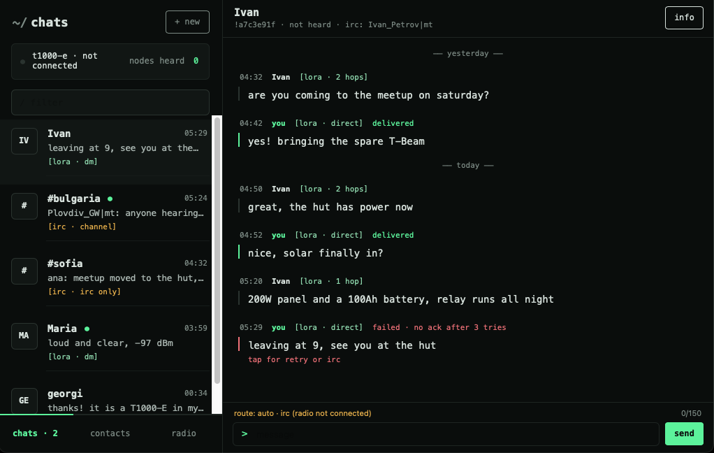
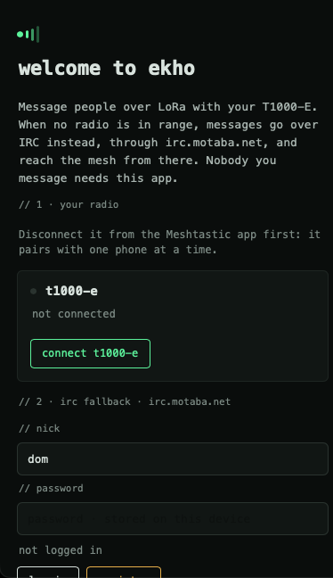

<p align="center">
  
</p>

<h1 align="center">ekho</h1>

<p align="center">
  Message people on the Bulgarian Meshtastic mesh from your phone or Mac.<br>
  Over the air when a radio is in range; over the internet when it isn't.
</p>

<p align="center">
  <a href="https://github.com/Casaide/ekho/releases"><b>Download</b></a> ·
  <a href="#getting-started">Getting started</a> ·
  <a href="#questions">Questions</a> ·
  <a href="#for-developers">For developers</a>
</p>

<p align="center">
  
  &nbsp;
  
  &nbsp;
  
</p>

Full guide with pictures: **[the wiki](https://github.com/Casaide/ekho/wiki)**.

## What it does

ekho is a messenger for people with a Meshtastic radio, such as the Seeed T1000-E. You talk to **people**, not networks: each person has one conversation, however the messages got there.

- **Over the air first.** When your radio has heard other radios recently, messages go out over LoRa, with no internet and no phone signal needed. Private messages show when they've been **delivered**.
- **Over the internet when you're out of range.** If no radio has been heard for a while, ekho sends over IRC on `irc.motaba.net`. The motaba bridge carries it onto the mesh for you, and brings replies back.
- **Nobody else needs ekho.** The people you write to keep using the Meshtastic app, or any IRC app.
- **Channels too.** `#bulgaria` and the regional channels (`#sofia`, `#varna`, `#burgas` and more) are a tap away. Channels your radio also has are marked as reaching the mesh; the rest are internet only.
- **See who's around.** The contacts tab shows everyone heard on the radio and everyone online in your channels, one entry per person.
- **Links come alive.** Pages show a preview with their picture, and a link to a sound or video plays right in the conversation: send a voice note as a link to the recording.
- **Bulgarian in English, if you like.** Turn on translation in the radio tab and messages with Bulgarian in them show in English, translated on your phone; hold one to see the original, or to translate any other. Switch on `→ bg` above the message box to write in English and send in Bulgarian, with the Bulgarian shown before it goes. The models (Mozilla's, from Firefox Translations) download once. On Android and the Mac.
- **You decide on failures.** If a radio message isn't delivered, ekho never resends it behind your back. Tap it to try the radio again or send it over the internet instead.

<p align="center">
  
</p>

## Getting started

### 1. Install

Download the latest version from the [releases page](https://github.com/Casaide/ekho/releases).

**Android** (Android 13 or newer)

1. Download `ekho-v….apk` on your phone and open it.
2. If Android asks, allow installing apps from your browser or files app.
3. Open ekho. When asked, allow **Nearby devices**. If you missed it: Settings › Apps › ekho › Permissions › Nearby devices.

New versions install over the old one; your conversations are kept.

**Mac** (Apple Silicon)

1. Download `ekho-v…-macos.zip` and open it.
2. Drag **ekho** into Applications.
3. The first time, right-click ekho and choose **Open**, then **Open** again. macOS asks this once, because the app isn't from the App Store.
4. Allow Bluetooth when asked.

### 2. Connect your radio



A Meshtastic radio pairs with **one device at a time**. Before connecting, close the Meshtastic app on your phone or turn off its Bluetooth connection, or ekho won't find the radio.

1. Make sure the radio is on.
2. On the welcome screen, tap **connect t1000-e**.
3. Wait for **connected**. The first time can take half a minute while ekho reads the radio's list of nodes.

ekho reconnects by itself when the radio comes back in range. You can always see how it's doing on the **radio** tab.

### 3. Set up the internet fallback (optional, recommended)

So you can still reach the mesh when you're out of radio range:

1. Choose a **nick** (your name on IRC) and a **password**.
2. Tap **register** the first time, or **login** if you already have an account on `irc.motaba.net`.

The password stays on your device. ekho logs in for you from then on, and joins `#bulgaria`.

<br clear="right">

## Using ekho

- **Start a conversation:** open **contacts**, pick someone heard on the radio or online on IRC, and write. Tap **lora** to list only people your radio knows, most recently heard first, or another chip for MeshCore, Bitchat or plain IRC users; the last chip switches between last seen and name order.
- **Where a message went** shows above it: `lora · direct`, `lora · 2 hops`, `irc`. The line at the bottom of a conversation says which way the next message will go.
- **Message details:** tap a message to see when and how it was sent, to copy it, to react with any emoji, or to retry a failed one.
- **Channels:** the **channels** tab lists the ones you're in, with how many people are there now and whether they reach the radio, then the rest of the server's channels to join. Open a channel's **info** to see who's in it, or **edit** to give it your own name. To leave one, go to **radio** › **irc**.
- **Go back** with the back gesture or the arrow at the top left.

### Use ekho on your Mac too

Your radio can only be connected to one device, so the phone keeps it, along with the internet connection, and the Mac links to the phone:

1. On the phone, go to **radio** › **link a device**. A code like `k7m2x-9qp4t` appears.
2. On the Mac, go to **radio**, type the code under **or link this device to your phone**, and tap **link**.

The Mac then shows all your conversations and sends through the phone. Keep ekho running on the phone. **Unlink** on the Mac makes it a device of its own again.

### What the labels mean

| Label       | Meaning                                                                                                   |
| ----------- | --------------------------------------------------------------------------------------------------------- |
| `sending`   | On its way over the radio, waiting for a receipt.                                                         |
| `delivered` | The other person's radio confirmed it.                                                                    |
| `failed`    | No receipt after 3 tries. Tap it to retry or send over the internet.                                      |
| `relayed`   | Another radio repeated your channel message, so it reached the mesh. Channels can't tell you who read it. |
| `sent`      | Sent over the internet. IRC gives no receipts, so nothing more will appear.                               |

## Questions

**Do I need the internet?**
No. With a radio and other radios nearby, everything works without it. The internet is only the fallback.

**Do I need a radio?**
Not to try it. Without one, ekho sends everything over the internet, and still reaches the mesh through the bridge.

**Will I get messages while ekho is closed?**
Yes, while it's running in the background: you'll see an ongoing "ekho is listening for messages" notification. Messages to you, and channel messages that mention you, show as notifications; tap one to open the conversation. Swiping ekho away from your recent apps closes it, and then nothing arrives until you open it again (your radio still holds radio messages for you).

**Will I see messages sent while I was offline?**
Radio messages, yes, from your radio's queue. IRC has no history, so internet messages sent while you were offline are missed.

**Why didn't my radio connect?**
Most often the Meshtastic app is still connected to it. Close it, then try again. Otherwise open **radio** › **view log**: it lists every step and what went wrong. Turning the radio off and on also helps.

**Why do some people's names end in `|mt`?**
That's how the bridge shows mesh users on IRC: `|mt` for Meshtastic, `|mc` for MeshCore, `|bc` for Bitchat.

**Are my messages private?**
Private messages over the radio are encrypted between the two radios. Messages over IRC aren't end-to-end encrypted: the server and the bridge can read them, and channel messages are public.

**Something's wrong.**
Open **radio** › **view log**, copy it, and [open an issue](https://github.com/Casaide/ekho/issues) with it.

## For developers

ekho is built on [Bare](https://github.com/holepunchto/bare) with [bare-native](https://github.com/holepunchto/bare-native) for the UI and [bare-meshtastic](https://github.com/holepunchto/bare-meshtastic) for the radio, in TypeScript (erasable syntax only). Start with [`AGENTS.md`](AGENTS.md), then [`docs/design.md`](docs/design.md), [`docs/plan.md`](docs/plan.md) and [`docs/connections.md`](docs/connections.md).

```
npm install
npm test             # bare-native-test test.ts
npm run lint         # prettier --check . && lunte
npm run typecheck    # tsc --noEmit
npm start -- --host darwin-arm64
sh scripts/build-macos.sh   # the macOS app, zipped
```

The screenshots above come from the real macOS app with demo data: run the **Screens** workflow and decode the images from its log (see `.github/workflows/screens.yml` and `scripts/demo-state.py`).

### The core, without the UI

```js
import { Messenger, Irc } from 'ekho'

const messenger = new Messenger({ ircChannel: '#bulgaria' })

messenger.setRadio(client) // a bare-meshtastic Client
messenger.setIrc(irc) // an Irc over a TLS socket

const ivan = messenger.contacts.add({ name: 'ivan', node: '!a7c3e91f', nick: 'ivanp' })

const msg = messenger.send(ivan, 'take the spare cable')
messenger.on('update', (m) => console.log(m.via, m.state))
```

#### `const messenger = new Messenger([options])`

Options:

- `contacts`: a `Contacts` instance
- `heard`: a `Heard` instance, which sets the "recently heard" window
- `node`: our own node ID, added to IRC messages
- `channelName`: name of the mesh channel thread, default `'mesh'`
- `ircChannel`: the IRC channel the bridge mirrors the mesh channel to

#### `messenger.setRadio(client)`, `messenger.setIrc(irc)`

Attach the radio and the IRC client as each one connects.

#### `messenger.route()`

`'lora'` if any node was heard inside the window, otherwise `'irc'`.

#### `const msg = messenger.send(contact, text[, { via }])`

Send a message by the current route, or by `via`. `msg.state` moves through `sending`, then `delivered` or `failed` on LoRa, `relayed` or `failed` on a LoRa channel, or `sent` on IRC.

#### `messenger.retry(msg)`, `messenger.sendViaIrc(msg)`

For a failed message: try LoRa again, or send it over IRC instead.

#### `messenger.thread(contact)`, `messenger.status()`

A contact's messages, and `{ radio, irc, heard, route }`.

Events: `message (msg, contact)`, `update (msg)`, `status`.

#### `const irc = new Irc(stream, { nick, password, channels })`

A minimal IRC client over a duplex stream: SASL or NickServ login, ghost reclaim, keepalive. `connect()`, `register([email])`, `identify()`, `join(channel)`, `part(channel)`, `list()`, `privmsg(target, text)`, `probe()`, `quit()`. Events: `ready`, `message`, `notice`, `error`, `close`.

### Releases

Every merge to `main` builds the Android APK and the macOS app and publishes them as a GitHub release. The version comes from the [Conventional Commits](https://www.conventionalcommits.org) since the last release: `feat` bumps minor, a breaking change bumps minor while on 0.x and major after, anything else bumps patch. When squash-merging, give the pull request a Conventional Commits title.

Android builds are signed with a fixed, public debug key (`android/debug.keystore`) for now, so updates install over each other, and are marked as pre-releases. To sign with your own key, add three repository secrets (Settings › Secrets and variables › Actions):

```
keytool -genkeypair -keystore release.keystore -alias ekho -keyalg RSA -keysize 4096 -validity 10000
base64 -w0 release.keystore   # the value of ANDROID_KEYSTORE
```

- `ANDROID_KEYSTORE`: the keystore, base64-encoded
- `ANDROID_KEYSTORE_PASSWORD`: its password
- `ANDROID_KEY_ALIAS`: `ekho`

Keep the keystore safe: Android only installs updates signed with the same key, so switching keys means uninstalling once.

### Releasing to testers (Google Play internal testing)

Each release can also go to Google Play's internal testing track: up to 100 testers you name by email, no review, on their phones within minutes. The release workflow builds an app bundle (`bare-build --package`), signs it with the upload key, and sends it with fastlane (`fastlane/Fastfile`), as Чети does. The version code comes from the release's version (`major * 1000000 + minor * 1000 + patch`), so each release is higher than the last.

Once:

1. Make the upload key, outside the repository, with a password you choose:
   `keytool -genkeypair -v -keystore ~/Keys/ekho-upload.jks -keyalg RSA -keysize 2048 -validity 10000 -alias upload`.
   Back it up with its password. Play App Signing holds the key that signs what testers install; a lost upload key can be reset through Play support.
2. Add two repository secrets:
   - `ANDROID_UPLOAD_KEYSTORE_BASE64`: `base64 -i ~/Keys/ekho-upload.jks | pbcopy`
   - `ANDROID_UPLOAD_KEYSTORE_PASSWORD`: its password

   From then on, each release has a signed `ekho-v….aab` beside the APK.

3. In the Play Console, create the app, set up Testing › Internal testing with your testers' emails (or a Google Group), and upload that `.aab` by hand to an internal testing release. Play's API can't make an app's very first release, and the package name, `casa.cassidy.ekho`, comes with this first upload. Copy the opt-in link for testers.
4. Give Чети's service account (or a new one with the Google Play Android Developer API enabled) access to ekho in Play Console › Users and permissions, with permission to release to testing tracks. Add its JSON key as the secret `PLAY_SERVICE_ACCOUNT_JSON`.
5. While the app is still a draft on Play (its setup isn't finished), uploads must be drafts too: set the repository variable `PLAY_RELEASE_STATUS` to `draft`, and delete it once the app is set up.

Then every release goes to internal testing by itself. The APK on GitHub and the app from Play are signed with different keys, so a phone can't update one with the other: uninstall to switch.

## License

Apache-2.0
