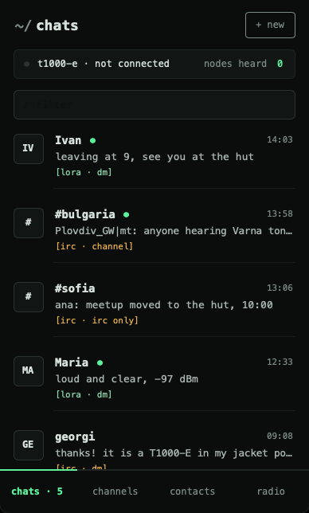
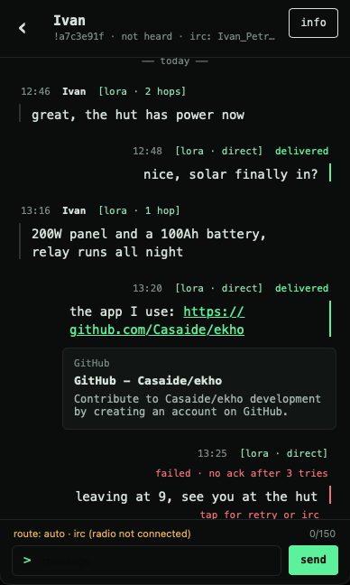
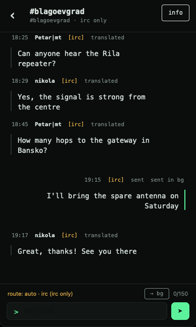

# ekho

A messenger for the Bulgarian Meshtastic community. You message people, not networks: one conversation per person or channel, whichever way each message travelled.

- **LoRa first:** ekho talks to your Meshtastic radio (a Seeed T1000-E) over Bluetooth, and sends over the mesh when other radios are around.
- **IRC when they aren't:** it falls back to `irc.motaba.net`, whose bridge carries messages into the mesh and back.
- **Nobody else needs it:** people keep their Meshtastic apps or IRC clients.

  
  
  

## Pages

- [[Getting started]]: install, pair the radio, log in to IRC
- [[Messaging]]: how a message goes, what its labels mean, replies, links, voice notes
- [[Channels]]: joining, the radio's channels, who's here
- [[People]]: contacts, joining someone's radio and nick, whois
- [[Translation]]: Bulgarian in English, and writing in Bulgarian
- [[IRC commands]]: `/whois`, `/me`, `/msg`, `/join`, `/part`
- [[Linking a Mac]]: the desktop, mirroring your phone
- [[Troubleshooting]]

These pages live in the repository, in `docs/wiki/`, and are published here on every merge. Edit them there.
