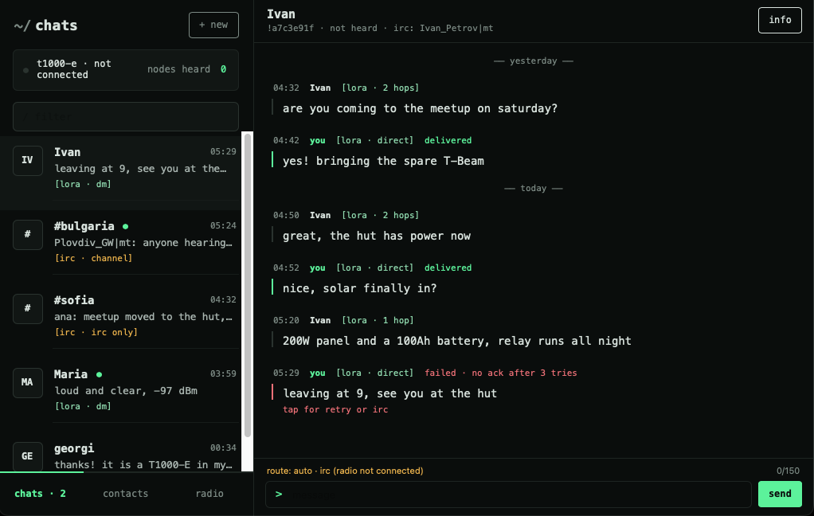

# Linking a Mac

The Mac mirrors your phone: same conversations, channels and people, and what you send from the Mac goes out through the phone. Only the phone talks to the radio and IRC.

1. On the phone, in the **radio** tab, tap **link a device ›**. It shows a ten-character code, which works for 10 minutes.
2. On the Mac, under **or link this device to your phone**, type the code and tap **link**.

The Mac then shows "via your phone" with the phone's radio and IRC state. The link is encrypted end to end, phone to Mac, with no server in between; it uses Holepunch's peer-to-peer stack.

- **Unlink** on the Mac, or **forget** the Mac on the phone, to undo it.
- Update both together: a phone on a newer ekho asks the Mac to update.
