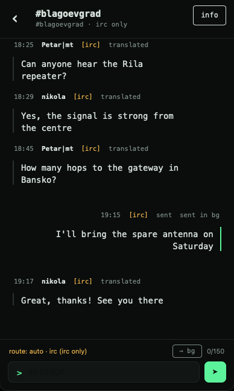

# Translation

Messages in Bulgarian can show in English, and you can write in English and send in Bulgarian. It runs on your phone or Mac: no message leaves the device.

## Turn it on

In the **radio** tab, under **translation**, tap `bg→en`. Mozilla's Bulgarian→English model (from Firefox Translations, about 30 MB) downloads once.

## Reading

- **Automatic:** a message with Bulgarian in it (a Cyrillic word or two) shows in English, labelled **translated**. English words in it, like "hop to gw", are left as they are.
- **The original:** hold the message. Its details show the original, with **show original** or **show english** to switch.
- **Anything else:** hold any message and tap **translate**. Bulgarian written in Latin letters ("kvo gotvite") is spelled in Cyrillic first, as the model reads Cyrillic.

Only the latest messages translate as you open a conversation; older ones translate when you hold them. Each translation is kept, so it's done once.

## Writing in Bulgarian

Tap **→ bg** above the message box. The first time, the English→Bulgarian model downloads. Then:

1. Type in English. The Bulgarian shows above the box as you type.
2. The send button turns amber, **bg ➤**.
3. What goes out is the Bulgarian. In your conversation it shows what you typed, labelled **sent in bg**, and its details show the Bulgarian that was sent.

## Where it works

Android and Apple Silicon Macs.
